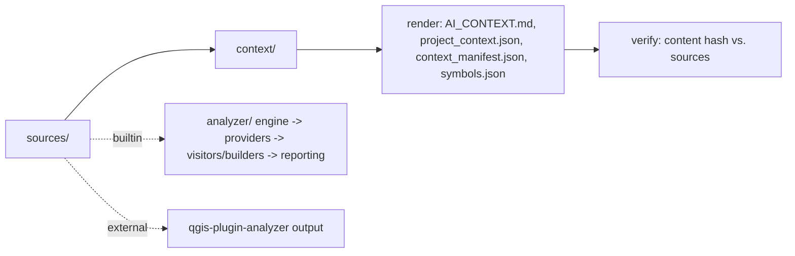

# Architecture of ai-context-core

This document describes the technical architecture of **ai-context-core**
(CLI `ai-ctx`) as of v5.0.1. Since v5.0.0 the project is a **context compiler**,
not a static-analysis engine: it *consumes* analysis and turns it into
token-efficient, versioned, verifiable context artifacts for AI agents
(see `docs/adr/0008-context-only-contract.md`).

## System overview

The compiler runs a four-stage pipeline:

```
source (extract)  ->  transform (enrich / budget / symbols)  ->  render (artifacts)  ->  verify (staleness)
```



## Layers

### Extraction — `sources/`
The pluggable extraction layer. An `AnalysisProvider` (protocol in
`sources/base.py`) produces a normalized `model.AnalysisResult`.

- `sources/builtin/` — the internal AST engine (`ProjectAnalyzer`) as a
  standalone fallback for non-QGIS Python projects.
- `sources/external/` — an adapter that consumes `qgis-plugin-analyzer` output
  (`analysis_results/project_context.json`, schema version 1).
- `sources/pipeline.py` — `compile_context()` resolves the source (per
  `--source auto|external|builtin`), collects it, and applies the **hybrid
  enrichment** that `ai-context-core` always owns: project structure, git
  evolution and manual notes.

Context-owned sections (structure, git, manual notes) are always computed here,
regardless of where the static analysis came from.

### Model — `model/`
`AnalysisResult` carries the normalized payload plus a `Provenance` block
(`source`, `schema`, `tool_version`, `git_sha`, `content_hash`). This provenance
is embedded into every rendered artifact as `_meta`.

### Transform — `context/`
- `budget.py` — token estimation (`chars / 4` heuristic; optional `tiktoken`)
  and deterministic, line-oriented truncation.
- `manifest.py` — renders the enabled sections and records exact per-section
  token deltas (`total == header + sum(sections)`).
- `symbol_index.py` — builds `symbols.json` (definitions and references with
  `file:line`).
- `verify.py` — hashes the analyzed Python inputs; `verify` exits `1` when the
  tracked sources changed since the last render.
- `health.py` — freshness, token usage, symbol coverage and provenance.

### Builtin engine — `analyzer/`
Used by `sources/builtin/`; follows the strict
**engine -> providers -> visitors/builders -> reporting** pipeline:

1. **Engine** (`engine.py`) orchestrates analysis, aggregation and output.
2. **Providers** (`providers/`): file scanning, ignore filtering, incremental
   cache and parallel workers.
3. **Visitors** (`visitors/`): pure AST traversal for context extraction
   (imports, metrics, structure). Visitors must not perform I/O — they detect and
   record; the engine reports.
4. **Builders** (`builders/`): aggregation, metric calculation and report
   composition, using the canonical keys in `builders/metric_keys.py`.
5. **Reporting**: `AI_CONTEXT.md`, `PROJECT_SUMMARY.md`, `project_context.json`
   (side-effect free; no analysis logic).

> i18n, security, QGIS compliance and quality-gate analysis are **not** part of
> this engine — they are owned by `qgis-plugin-analyzer` and consumed via
> `sources/external/`.

### CLI — `cli/`
A thin Click front-end: parse args -> dispatch to command logic -> pipeline.
No analysis logic lives in the CLI layer. Commands: `context` (primary),
`analyze`, `verify`, `symbols`, `health`, plus inspection helpers (`stats`,
`deps`, `git`, `graph`, `roadmap`, `compare`, `help-me`) and setup
(`init`, `profiles`, `clean`).

## Generated artifacts

| Artifact | Description |
| :--- | :--- |
| `AI_CONTEXT.md` | Structured, token-budgeted context for LLMs. |
| `project_context.json` | Machine-readable analysis payload + `_meta` provenance. |
| `context_manifest.json` | Per-section token counts, budget and total. |
| `symbols.json` | Versioned symbol index (definitions + references). |
| `PROJECT_SUMMARY.md` | Human-readable summary (emitted by `analyze`). |

Configuration lives in `src/ai_context_core/config/defaults.toml` and an optional
project `.ai-context/config.toml`; see `docs/CONFIGURATION.md`.

## Concurrency and performance

1. **Incremental cache** — hybrid `mtime` + SHA-256 fingerprint (`.ai_context_cache.json`);
   `--no-cache` bypasses it. Configuration changes require a `--no-cache` run
   because the cache key does not include config.
2. **Adaptive parallelism** — sequential below `PARALLEL_MIN_FILES`, batched
   `ProcessPoolExecutor` above it.
3. **Fast ignore** — compiled-regex filtering via `.analyzerignore`.

## Related documents

- `docs/adr/0008-context-only-contract.md` — the context-only contract.
- `docs/CONFIGURATION.md` — configuration reference.
- `README.md` — user-facing overview and command reference.

---
**Version**: 5.0.1 | **License**: GPL v3
